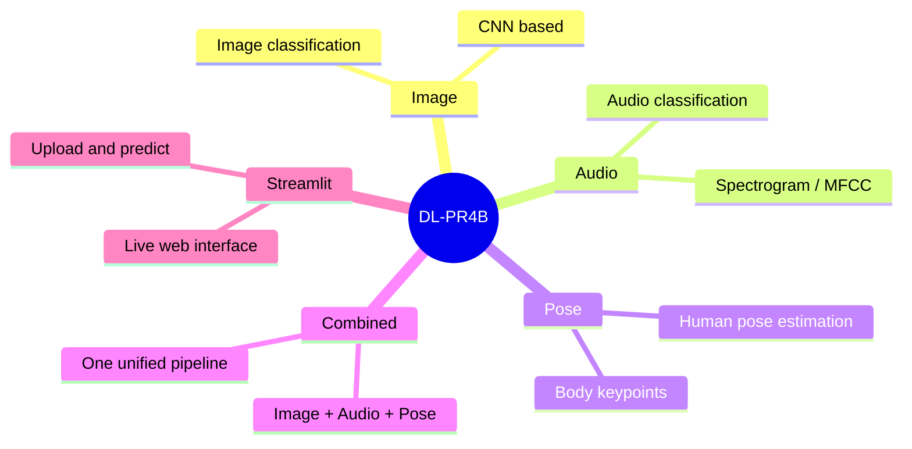
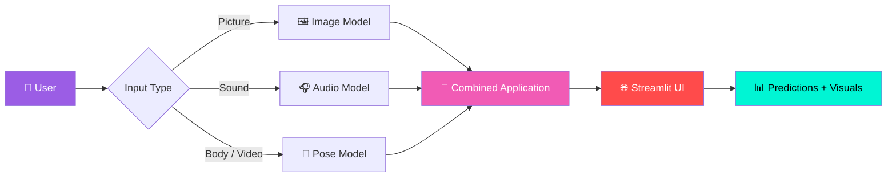

<div align="center">


# 🧠 DL-PR4B — Deep Learning Practical 4B

**One project. Three senses. Infinite curiosity.**
*A multimodal deep-learning suite that can **see** images, **hear** audio and **understand** human body pose — then fuses them into a single smart application.*


[🚀 Quick Start](#-quick-start) • [🧩 Modules](#-the-four-modules) • [🏗 Architecture](#-architecture) • [📸 Results](#-results-gallery) • [📂 Structure](#-repository-structure)

</div>

---

## ✨ Why this project is different

| 🎯 Typical practical | 🔥 DL-PR4B |
|---|---|
| One data type | **Three modalities** — vision, sound, motion |
| Notebook output only | **Interactive Streamlit web app** |
| Separate experiments | **Combined application** that fuses all of them |
| Text results | **Visual proof** — screenshots of every result |

---

## 🧩 The Four Modules



| Module | What it does | Input | Output |
|:--:|---|---|---|
| 🖼 **Image** | Recognises what is inside a picture using a deep neural network | `.jpg` / `.png` | Class label + confidence |
| 🎧 **Audio** | Listens to a sound clip and identifies it | `.wav` / `.mp3` | Predicted sound class |
| 🕺 **Pose** | Detects the human body and tracks keypoints | Image / webcam | Skeleton overlay |
| 🔗 **Combined** | Merges all three senses into one application | Mixed | Unified result |

> 📖 Module details → [`DL_PR4B/README.md`](DL_PR4B/README.md)
> 🌐 Web app guide → [`streamlit/README.md`](streamlit/README.md)

---

## 🏗 Architecture



---

## 🚀 Quick Start

```bash
# 1️⃣ Clone
git clone https://github.com/hetttk/DL-PR4B-Deep-Learning.git
cd DL-PR4B-Deep-Learning

# 2️⃣ Virtual environment (recommended)
python -m venv venv
source venv/bin/activate        # Windows: venv\Scripts\activate

# 3️⃣ Install dependencies
pip install -r requirements.txt   # use the requirements file of the module you run

# 4️⃣ Launch the web app
cd streamlit
streamlit run app.py              # change app.py to your real file name
```

Open **http://localhost:8501** 🎉

---

## 📂 Repository Structure

```text
DL-PR4B-Deep-Learning/
│
├── 📁 DL_PR4B/            ← Core deep-learning work
│   └── README.md            (image · audio · pose · combined application)
│
├── 📁 streamlit/          ← Interactive web application
│   └── README.md
│
├── 📁 screenshots/        ← Result screenshots of both projects
│   ├── dl_pr4b/
│   └── streamlit/
│
├── 📁 assets/             ← Banner & design assets
├── 📄 .gitignore
└── 📄 README.md           ← You are here
```

---

## 📸 Results Gallery

Quick preview — full gallery in [`screenshots/README.md`](screenshots/README.md).

| 🧪 DL_PR4B | 🌐 Streamlit |
|:--:|:--:|
|  |  |

---

## 🛠 Tech Stack

| Layer | Tools |
|---|---|
| Language | Python |
| Deep Learning | TensorFlow / Keras or PyTorch *(edit to match your code)* |
| Vision & Pose | OpenCV, MediaPipe *(edit)* |
| Audio | Librosa *(edit)* |
| Web UI | Streamlit |
| Data & Plots | NumPy, Pandas, Matplotlib |

---

## 🎓 What I Learned

- Building neural networks for **three different data types**
- Turning raw audio into model-ready features
- **Human pose estimation**
- Fusing separate models into **one product**
- Deploying ML with a clean **Streamlit** interface

---

## 👨‍💻 Author

**hetttk** — [GitHub](https://github.com/hetttk)

<div align="center">

⭐ *If this project impressed you, drop a star!* ⭐

</div>
