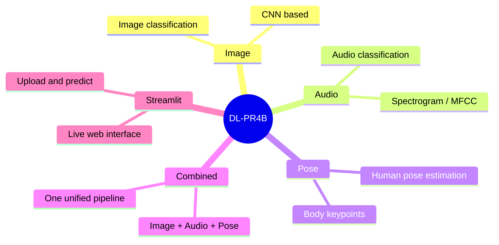
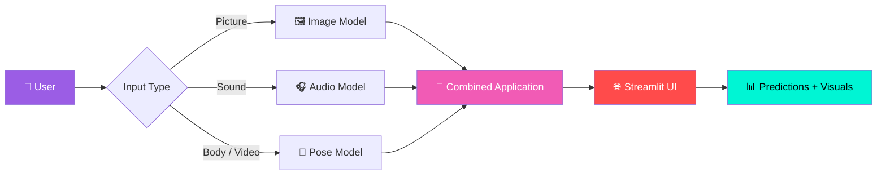

<div align="center">

!<svg xmlns="http://www.w3.org/2000/svg" viewBox="0 0 1200 320" width="1200" height="320">
<defs>
<linearGradient id="g" x1="0" y1="0" x2="1" y2="1"><stop offset="0" stop-color="#0f0c29"/><stop offset=".5" stop-color="#302b63"/><stop offset="1" stop-color="#24243e"/></linearGradient>
<linearGradient id="t" x1="0" x2="1"><stop offset="0" stop-color="#00f5d4"/><stop offset=".5" stop-color="#9b5de5"/><stop offset="1" stop-color="#f15bb5"/></linearGradient>
</defs>
<rect width="1200" height="320" rx="24" fill="url(#g)"/>
<g stroke="#9b5de5" stroke-opacity=".35" stroke-width="1.5" fill="none">
<path d="M60 60 L200 130 L60 200 M60 60 L200 200 M60 200 L200 60"/>
<path d="M200 130 L340 80 M200 130 L340 190 M200 60 L340 80 M200 200 L340 190"/>
<path d="M1000 70 L1140 140 L1000 210 M1000 70 L1140 210 M1000 210 L1140 70"/>
</g>
<g fill="#00f5d4"><circle cx="60" cy="60" r="7"/><circle cx="60" cy="200" r="7"/><circle cx="200" cy="130" r="7"/><circle cx="200" cy="60" r="7"/><circle cx="200" cy="200" r="7"/><circle cx="340" cy="80" r="7"/><circle cx="340" cy="190" r="7"/></g>
<g fill="#f15bb5"><circle cx="1000" cy="70" r="7"/><circle cx="1000" cy="210" r="7"/><circle cx="1140" cy="140" r="7"/><circle cx="1140" cy="70" r="7"/><circle cx="1140" cy="210" r="7"/></g>
<text x="600" y="145" text-anchor="middle" font-family="Segoe UI,Helvetica,Arial,sans-serif" font-size="64" font-weight="800" fill="url(#t)">DL · PR4B</text>
<text x="600" y="200" text-anchor="middle" font-family="Segoe UI,Helvetica,Arial,sans-serif" font-size="26" fill="#e0e0ff" letter-spacing="6">SEE · HEAR · MOVE — DEEP LEARNING IN ONE APP</text>
<text x="600" y="255" text-anchor="middle" font-family="monospace" font-size="18" fill="#9b9bd0">Image  +  Audio  +  Pose  →  Combined Intelligence</text>
</svg>


# 🧠 DL-PR4B — Deep Learning Practical 4B

**One project. Three senses. Infinite curiosity.**
*A multimodal deep-learning suite that can **see** images, **hear** audio and **understand** human body pose — then fuses them into a single smart application.*


[🚀 Quick Start](#-quick-start) • [🧩 Modules](#-the-four-modules) • [🏗 Architecture](#-architecture) • [📸 Results](#-results-gallery) • [📂 Structure](#-repository-structure)

</div>

---

## ✨ Why this project is different

| 🎯 Typical practical | 🔥 DL-PR4B |
|---|---|
| One data type | **Three modalities** — vision, sound, motion |
| Notebook output only | **Interactive Streamlit web app** |
| Separate experiments | **Combined application** that fuses all of them |
| Text results | **Visual proof** — screenshots of every result |

---

## 🧩 The Four Modules



| Module | What it does | Input | Output |
|:--:|---|---|---|
| 🖼 **Image** | Recognises what is inside a picture using a deep neural network | `.jpg` / `.png` | Class label + confidence |
| 🎧 **Audio** | Listens to a sound clip and identifies it | `.wav` / `.mp3` | Predicted sound class |
| 🕺 **Pose** | Detects the human body and tracks keypoints | Image / webcam | Skeleton overlay |
| 🔗 **Combined** | Merges all three senses into one application | Mixed | Unified result |

> 📖 Module details → [`DL_PR4B/README.md`](DL_PR4B/README.md)
> 🌐 Web app guide → [`streamlit/README.md`](streamlit/README.md)

---

## 🏗 Architecture



---

## 🚀 Quick Start

```bash
# 1️⃣ Clone
git clone https://github.com/hetttk/DL-PR4B-Deep-Learning.git
cd DL-PR4B-Deep-Learning

# 2️⃣ Virtual environment (recommended)
python -m venv venv
source venv/bin/activate        # Windows: venv\Scripts\activate

# 3️⃣ Install dependencies
pip install -r requirements.txt   # use the requirements file of the module you run

# 4️⃣ Launch the web app
cd streamlit
streamlit run app.py              # change app.py to your real file name
```

Open https://dl-pr4b-deep-learning.streamlit.app/🎉

---

## 📂 Repository Structure

```text
DL-PR4B-Deep-Learning/
│
├── 📁 DL_PR4B/            ← Core deep-learning work
│   └── README.md            (image · audio · pose · combined application)
│
├── 📁 streamlit/          ← Interactive web application
│   └── README.md
│
├── 📁 screenshots/        ← Result screenshots of both projects
│   ├── dl_pr4b/
│   └── streamlit/
│
├── 📁 assets/             ← Banner & design assets
├── 📄 .gitignore
└── 📄 README.md           ← You are here
```

---

## 📸 Results Gallery

Quick preview — full gallery in [`screenshots/README.md`](screenshots/README.md).

| 🧪 DL_PR4B | 🌐 Streamlit |
|:--:|:--:|
|  |  |

---

## 🛠 Tech Stack

| Layer | Tools |
|---|---|
| Language | Python |
| Deep Learning | TensorFlow / Keras or PyTorch *(edit to match your code)* |
| Vision & Pose | OpenCV, MediaPipe *(edit)* |
| Audio | Librosa *(edit)* |
| Web UI | Streamlit |
| Data & Plots | NumPy, Pandas, Matplotlib |

---

## 🎓 What I Learned

- Building neural networks for **three different data types**
- Turning raw audio into model-ready features
- **Human pose estimation**
- Fusing separate models into **one product**
- Deploying ML with a clean **Streamlit** interface

---

## 👨‍💻 Author

**hetttk** — [GitHub](https://github.com/hetttk)
streamlit link: https://dl-pr4b-deep-learning.streamlit.app/
linkedin: https://www.linkedin.com/in/het-kapadnekar-a96aa7350 
email: hetkapadnekar06@gmail.com

<div align="center">

⭐ *If this project impressed you, drop a star!* ⭐

</div>
