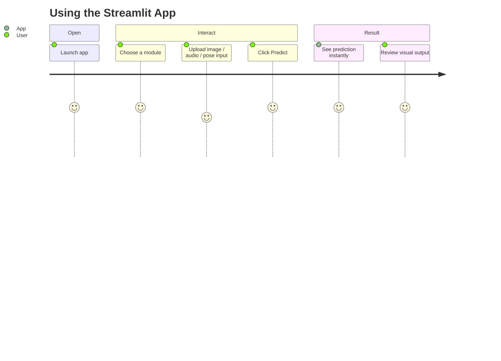

<div align="center">

# 🌐 Streamlit App — Deep Learning, Made Interactive

**Upload. Click. Watch the AI think.**


</div>

> ⬅️ Back to [Root README](../README.md) • 🧪 Core models: [DL_PR4B](../DL_PR4B/README.md)

## 🎯 What is this?

The **Streamlit application** wraps the deep-learning models in a clean web interface, so anyone can test them **without writing a single line of code**.

## 🎬 User journey



## ✨ Features

| Feature | Description |
|---|---|
| 🧭 **Sidebar navigation** | Switch between modules instantly |
| 📤 **File upload** | Drag & drop images and audio |
| ⚡ **Instant predictions** | Results in seconds |
| 🎨 **Visual output** | Labels, confidence and skeleton overlays |
| 🧩 **Modular code** | Easy to extend with new models |

## 🚀 Run it locally

```bash
cd streamlit
pip install streamlit
pip install -r requirements.txt
streamlit run app.py        # use your actual main file name
```

Open **http://localhost:8501** 🎉

## 🖥 App preview

| Home | Prediction |
|:--:|:--:|
|  |  |

## 🛠 Troubleshooting

| Problem | Fix |
|---|---|
| `streamlit: command not found` | `pip install streamlit` |
| Model file not found | Check the model path inside the script |
| Port busy | `streamlit run app.py --server.port 8502` |
